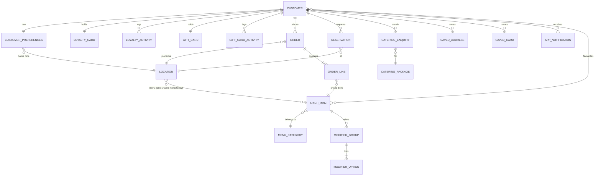

# EightyTwenty Mobile: Data Models

> **Status: PROPOSED wire format.** The **domain** types below are the app's real TypeScript types (`src/types/*.ts`). The **wire** (DTO) shapes and the mapping between them are a proposal for a backend that **does not exist yet**. No server implements these shapes today. The base URL comes from `EXPO_PUBLIC_API_BASE_URL`, which is a placeholder. Endpoints are covered in [`API_CONTRACTS.md`](./API_CONTRACTS.md). The wider handoff is in [`BACKEND_HANDOFF.md`](./BACKEND_HANDOFF.md), and image assets are in [`ASSET_AUDIT.md`](./ASSET_AUDIT.md).

| Layer | File | Notes |
|---|---|---|
| Domain model | `src/types/*.ts` | What screens, hooks and business rules use. Money in decimal dollars, display-style enums. |
| Wire format (proposed) | `src/services/api/dto.ts` | camelCase JSON, integer cents (`*Cents`), ISO-8601 timestamps with offset, snake_case enums. |
| Mapping | `src/services/api/mappers.ts` | The only place wire → domain conversion happens. Request bodies are built in `src/services/api/repositories.ts`. |
| Mock data | `src/services/mock/catalog.ts`, `fixtures/*` | Builds domain objects directly from fixtures (no DTOs). |

Definitions are copied from the source, comments included. If this document and the code disagree, the code wins.

---

## Contents

1. [Primitives](#1-primitives)
2. [Session](#2-session)
3. [Customer](#3-customer)
4. [Locations](#4-locations)
5. [Menu](#5-menu)
6. [Cart and orders](#6-cart-and-orders)
7. [Payments](#7-payments)
8. [Loyalty](#8-loyalty)
9. [Reservations](#9-reservations)
10. [Catering](#10-catering)
11. [Gift cards](#11-gift-cards)
12. [Notifications and content](#12-notifications-and-content)
13. [Entity relationships](#13-entity-relationships)
14. [Images](#14-images)
15. [Time zones](#15-time-zones)
16. [Money precision](#16-money-precision)
17. [Mapper fallbacks for unknown values](#17-mapper-fallbacks-for-unknown-values)

---

## 1. Primitives

`src/types/common.ts`

```ts
export type ID = string;
/** Calendar date, `YYYY-MM-DD`, in the café's local time (Australia/Canberra). */
export type ISODate = string;
/** 24h wall-clock time, `HH:MM`. */
export type TimeOfDay = string;
/** ISO-8601 timestamp with offset, e.g. `2026-10-08T08:12:00+11:00`. */
export type ISODateTime = string;
/** Australian dollars as a decimal number (e.g. 27.5). API mappers convert from cents. */
export type Money = number;

/**
 * Anything expo-image can render: a bundled asset (number from require) in mock mode,
 * or a remote URL in API mode.
 */
export type ImageSource = number | { uri: string };

/** Cursor pagination used by every list endpoint that can grow. */
export interface Page<T> {
  items: T[];
  nextCursor: string | null;
}

export interface PageRequest {
  cursor?: string | null;
  limit?: number;
}
```

| Type | Wire | Notes |
|---|---|---|
| `ID` | `string` | Opaque. Never parsed by the app. |
| `ISODate` | `string` `YYYY-MM-DD` | Café-local calendar date (§15). |
| `TimeOfDay` | `string` `HH:MM` | 24-hour, café-local. |
| `ISODateTime` | `string` | ISO-8601 with offset. |
| `Money` | `number` (integer cents, field suffix `Cents`) | Domain uses decimal dollars (§16). |
| `ImageSource` | `string \| null` (`imageUrl`) | `{ uri }` in API mode, bundled `number` in mock mode (§14). |

### `Page<T>` / `PageRequest`

| Field | Type | Meaning | Notes |
|---|---|---|---|
| `items` | `T[]` | One page of results | Newest first for history lists. |
| `nextCursor` | `string \| null` | Cursor for the next page | `null` = last page. Opaque. |
| `cursor` (request) | `string \| null` (optional) | Where to continue | Sent as `?cursor=`. Omitted when empty. |
| `limit` (request) | `number` (optional) | Page size | Sent as `?limit=`. The app uses 20. |

**Domain ↔ wire** (`PageDTO<T>`): identical shape, `{ items, nextCursor }`. Items are mapped one by one.

---

## 2. Session

`src/types/index.ts`

```ts
/** Authenticated session. Tokens are stored in the device keychain/keystore. */
export interface Session {
  customerId: string;
  accessToken: string;
  refreshToken: string | null;
  /** ISO timestamp; `null` when the token doesn't expire (mock). */
  expiresAt: string | null;
  /** True when issued by the local mock provider — never treat as real auth. */
  isDemo: boolean;
}
```

| Field | Type | Meaning | Notes |
|---|---|---|---|
| `customerId` | `string` | Signed-in customer | Same value as `Customer.id`. |
| `accessToken` | `string` | Bearer token for authenticated calls | Stored in keychain/keystore. |
| `refreshToken` | `string \| null` | Exchanged at `POST /auth/refresh` | `null` = cannot refresh; a 401 then cannot be recovered. |
| `expiresAt` | `string \| null` | Access-token expiry | Used only when restoring a stored session. No proactive refresh. |
| `isDemo` | `boolean` | Issued by the mock | **Not on the wire.** `sessionFromDto` sets `false`. |

Request types used by `AuthRepository` (`src/repositories/contracts.ts`), sent unmapped:

```ts
export interface SignInRequest {
  email: string;
  password: string;
}

export interface SignUpRequest {
  name: string;
  phone: string;
  email: string;
  password: string;
}
```

**Domain ↔ wire** (`SessionDTO`)

| Domain | Wire | Conversion |
|---|---|---|
| `customerId` | `customerId` | — |
| `accessToken` | `accessToken` | — |
| `refreshToken` | `refreshToken` | — |
| `expiresAt` | `expiresAt` | — |
| `isDemo` | — | Client-only, always `false` from the API |

---

## 3. Customer

`src/types/customer.ts`

### `Customer`

```ts
export interface Customer {
  id: ID;
  name: string;
  email: string;
  phone: string;
  memberSince: ISODate;
}
```

| Field | Type | Meaning | Notes |
|---|---|---|---|
| `id` | `ID` | Customer id | e.g. `cus_demo_sophie`. |
| `name` | `string` | Full name | The app shows the first name and initials. |
| `email` | `string` | Login email | Unique; case-insensitive. |
| `phone` | `string` | Contact number | Free text. Must contain at least 8 digits at sign-up. |
| `memberSince` | `ISODate` | Sign-up date | Canberra-local date. |

**Domain ↔ wire** (`CustomerDTO`): identical fields; `customerFromDto` spreads the DTO.

### `CustomerUpdate`

```ts
export type CustomerUpdate = Partial<Pick<Customer, 'name' | 'email' | 'phone'>>;
```

| Field | Type | Meaning | Notes |
|---|---|---|---|
| `name` | `string` (optional) | New name | Not blank when present. |
| `email` | `string` (optional) | New email | Loose email pattern when present. |
| `phone` | `string` (optional) | New phone | — |

**Domain ↔ wire:** sent unmapped as the `PATCH /me` body. Absent keys are unchanged.

### `DietaryPreference`

```ts
export type DietaryPreference = 'Gluten free' | 'Dairy free' | 'Vegan' | 'Vegetarian';
```

| Domain value | Wire (`PreferencesDTO.dietary`) | Menu code (`DIETARY_OPTIONS`) |
|---|---|---|
| `'Gluten free'` | `gluten_free` | GF |
| `'Dairy free'` | `dairy_free` | DF |
| `'Vegan'` | `vegan` | VG |
| `'Vegetarian'` | `vegetarian` | V |

> Exception: `CateringEnquiryRequest.dietary` is sent with the **domain** values (`'Gluten free'`, …), not the snake_case ones.

### `NotificationCategory`

```ts
export type NotificationCategory = 'Order updates' | 'Bookings' | 'Coffee card' | 'Offers & news' | 'Gift card activity';
```

| Domain value | Wire key (`PreferencesDTO.notifications`) | Default for a new account |
|---|---|---|
| `'Order updates'` | `orderUpdates` | `true` |
| `'Bookings'` | `bookings` | `true` |
| `'Coffee card'` | `coffeeCard` | `true` |
| `'Offers & news'` | `offersAndNews` | `false` |
| `'Gift card activity'` | `giftCardActivity` | `true` |

### `SecuritySettings`

```ts
export interface SecuritySettings {
  /** Sign in with Face ID — UI preference only until biometric sign-in is implemented. */
  biometricSignIn: boolean;
  useLocation: boolean;
  rememberOrderSettings: boolean;
}
```

| Field | Type | Meaning | Notes |
|---|---|---|---|
| `biometricSignIn` | `boolean` | Face ID sign-in toggle | UI preference only; not implemented. |
| `useLocation` | `boolean` | Allow location use | — |
| `rememberOrderSettings` | `boolean` | Keep the last order context | — |

**Domain ↔ wire:** identical object (`PreferencesDTO.security`).

### `CustomerPreferences`

```ts
export interface CustomerPreferences {
  homeCafeId: ID;
  dietary: DietaryPreference[];
  notifications: Record<NotificationCategory, boolean>;
  security: SecuritySettings;
  /** Index into the avatar palette (profile icon). */
  avatar: number;
}
```

| Field | Type | Meaning | Notes |
|---|---|---|---|
| `homeCafeId` | `ID` | The customer's home café | A `Location.id`. Default for new accounts: `phillip`. |
| `dietary` | `DietaryPreference[]` | Dietary preferences | Highlights matching menu chips. |
| `notifications` | `Record<NotificationCategory, boolean>` | Per-category opt-ins | All five keys always present. |
| `security` | `SecuritySettings` | Privacy and security toggles | — |
| `avatar` | `number` | Profile icon index | 0–5 (6 palette entries in `Avatar.tsx`). |

**Domain ↔ wire** (`PreferencesDTO`; `preferencesFromDto` / `preferencesToDto`)

| Domain | Wire | Conversion |
|---|---|---|
| `homeCafeId` | `homeCafeId` | — |
| `dietary: DietaryPreference[]` | `dietary: ('gluten_free' \| 'dairy_free' \| 'vegan' \| 'vegetarian')[]` | Per value (table above) |
| `notifications: Record<NotificationCategory, boolean>` | `notifications: { orderUpdates, bookings, coffeeCard, offersAndNews, giftCardActivity }` | Key rename (table above) |
| `security` | `security` | — |
| `avatar` | `avatar` | — |

`PATCH` sends `Partial<PreferencesDTO>`. Only keys present in the patch are sent, and nested objects are sent complete.

### `AddressLabel` / `SavedAddress`

```ts
export type AddressLabel = 'Home' | 'Work' | 'Other';

export interface SavedAddress {
  id: ID;
  label: AddressLabel;
  line: string;
}
```

| Field | Type | Meaning | Notes |
|---|---|---|---|
| `id` | `ID` | Address id | Server-assigned. |
| `label` | `AddressLabel` | Home / Work / Other | — |
| `line` | `string` | Single-line delivery address | Trimmed. Not blank. Not geocoded. |

**Domain ↔ wire** (`AddressDTO`)

| Domain | Wire | Conversion |
|---|---|---|
| `id` | `id` | — |
| `label: 'Home' \| 'Work' \| 'Other'` | `label: 'home' \| 'work' \| 'other'` | Response: mapped (unknown → `Other`). Request: `label.toLowerCase()` |
| `line` | `line` | — |

---

## 4. Locations

`src/types/location.ts`

### `FulfilmentMethod`

```ts
export type FulfilmentMethod = 'Pickup' | 'Delivery' | 'Dine In';
```

| Domain value | Wire (`MethodDTO`) | Meaning |
|---|---|---|
| `'Pickup'` | `pickup` | Collect from the counter |
| `'Delivery'` | `delivery` | Delivered to `deliveryAddress`; adds 10% to the order |
| `'Dine In'` | `dine_in` | Served to `tableNumber` |

### `Weekday`, `OpeningWindow`, `WeeklyHours`

```ts
/** 0 = Sunday … 6 = Saturday (JavaScript `Date#getDay`). */
export type Weekday = 0 | 1 | 2 | 3 | 4 | 5 | 6;

export interface OpeningWindow {
  open: TimeOfDay;
  close: TimeOfDay;
}

/** Structured opening hours. `null` = closed that day. */
export type WeeklyHours = Record<Weekday, OpeningWindow | null>;
```

| Field | Type | Meaning | Notes |
|---|---|---|---|
| `OpeningWindow.open` | `TimeOfDay` | Opening time | Canberra-local `HH:MM`. |
| `OpeningWindow.close` | `TimeOfDay` | Closing time | The last booking is 30 min before this. |
| `WeeklyHours[0…6]` | `OpeningWindow \| null` | Hours per weekday | `null` = closed that day. |

**Domain ↔ wire** (`LocationDTO.weeklyHours: Record<WeekdayKeyDTO, { open, close } | null> | null`)

| Domain key | Wire key |
|---|---|
| `0` | `sun` |
| `1` | `mon` |
| `2` | `tue` |
| `3` | `wed` |
| `4` | `thu` |
| `5` | `fri` |
| `6` | `sat` |

A missing wire key maps to `null` (closed). `weeklyHours: null` on the wire stays `null`, meaning hours TBC.

### `Location`

```ts
export interface Location {
  id: ID;
  name: string;
  /** e.g. "Lonsdale St", "19 Mort Street · Quick Service" */
  subtitle: string;
  /** Short area label used on cards, e.g. "Tuggeranong". */
  area: string;
  /** Editorial headline on the Home featured card. */
  headline: string;
  address: string;
  phone: string | null;
  email: string | null;
  /** Human-readable hours exactly as published, e.g. "Mon–Sun 6:00am – 3:00pm". */
  hoursLabel: string;
  hoursShort: string;
  /** Structured hours; `null` while hours are to be confirmed. */
  weeklyHours: WeeklyHours | null;
  /** `comingSoon` venues are listed but can't take orders or bookings. */
  status: 'open' | 'comingSoon';
  methods: FulfilmentMethod[];
  note: string;
  /** Typical ASAP wait, e.g. "20–25 min". `null` falls back to the default wait. */
  waitLabel: string | null;
  image: ImageSource | null;
  /** Additional photography (not rendered by the current design — see docs/ASSET_AUDIT.md). */
  gallery: ImageSource[];
  /** Existing third-party online ordering URL (TapTouch / lifeintouch). */
  externalOrderUrl: string | null;
  /** Name used by the café's booking inbox. */
  bookingLabel: string;
  flags: {
    flagship?: boolean;
    limitedMenu?: boolean;
    glutenFree?: boolean;
  };
}
```

| Field | Type | Meaning | Notes |
|---|---|---|---|
| `id` | `ID` | Café id | e.g. `braddon`, `phillip`. |
| `name` | `string` | Café name | "Braddon". |
| `subtitle` | `string` | Secondary line | "Lonsdale St". |
| `area` | `string` | Short card label | "Tuggeranong". |
| `headline` | `string` | Home featured-card copy | — |
| `address` | `string` | Street address | — |
| `phone` | `string \| null` | Café phone | `null` when not published. |
| `email` | `string \| null` | Café inbox | Booking requests go here; fallback is `info@`. |
| `hoursLabel` | `string` | Published hours text | Display only. |
| `hoursShort` | `string` | Compact hours | "7am – 3pm, weekdays". |
| `weeklyHours` | `WeeklyHours \| null` | Structured hours | `null` = TBC, and the café is then treated as coming soon. |
| `status` | `'open' \| 'comingSoon'` | Trading status | `comingSoon`: listed, but no orders or bookings. |
| `methods` | `FulfilmentMethod[]` | Offered order methods | Checked by `POST /orders`. |
| `note` | `string` | Short descriptive note | `""` when none. |
| `waitLabel` | `string \| null` | Typical ASAP wait | `null` → "15–20 min". |
| `image` | `ImageSource \| null` | Hero photo | — |
| `gallery` | `ImageSource[]` | Extra photos | Not rendered by the current design. |
| `externalOrderUrl` | `string \| null` | Existing third-party ordering link | — |
| `bookingLabel` | `string` | Name used in the booking inbox | — |
| `flags.flagship` | `boolean` (optional) | Flagship café | — |
| `flags.limitedMenu` | `boolean` (optional) | Limited / express menu | Not linked to menu data yet. |
| `flags.glutenFree` | `boolean` (optional) | Gluten-free café | Not linked to menu data yet. |

**Domain ↔ wire** (`LocationDTO`; `locationFromDto`)

| Domain | Wire | Conversion |
|---|---|---|
| `id`, `name`, `subtitle`, `area`, `headline`, `address`, `phone`, `email`, `hoursLabel`, `hoursShort`, `note`, `waitLabel`, `externalOrderUrl`, `bookingLabel`, `flags` | same names | — |
| `weeklyHours` (keys `0…6`) | `weeklyHours` (keys `sun…sat`) | Key conversion (above) |
| `status: 'comingSoon'` | `status: 'coming_soon'` | `coming_soon` → `comingSoon`; anything else → `open` |
| `methods: FulfilmentMethod[]` | `fulfilmentMethods: MethodDTO[]` | **Renamed field.** Values: `pickup` ↔ `Pickup`, `delivery` ↔ `Delivery`, `dine_in` ↔ `Dine In` |
| `image: ImageSource \| null` | `imageUrl: string \| null` | `url` → `{ uri: url }`; `null`/`""` → `null` |
| `gallery: ImageSource[]` | `galleryUrls: string[]` | Each → `{ uri }` |

---

## 5. Menu

`src/types/menu.ts`

### `MenuCategory`

```ts
export interface MenuCategory {
  id: ID;
  name: string;
  /** Compact label for the category rail, e.g. "Bites". */
  shortName: string;
  /** Service note shown beside the category heading. */
  note: string;
}
```

| Field | Type | Meaning | Notes |
|---|---|---|---|
| `id` | `ID` | Category id | `coffee` and `cold` drive stamp eligibility (`isCoffeeItem`). |
| `name` | `string` | Full name | "Coffee & Hot Drinks". |
| `shortName` | `string` | Rail label | "Coffee". |
| `note` | `string` | Service note | "Monday – Sunday, 6am–3pm"; `""` when none. |

**Domain ↔ wire** (`MenuCategoryDTO`): identical; `categoryFromDto` spreads the DTO.

### `ModifierOption`

```ts
export interface ModifierOption {
  name: string;
  /** Price added to the item, 0 for no charge. */
  price: Money;
}
```

| Field | Type | Meaning | Notes |
|---|---|---|---|
| `name` | `string` | Option name | Also its **identifier** in `ModifierSelections`. Unique within the group. |
| `price` | `Money` | Surcharge for the option | `0` = no charge. |

### `ModifierGroup`

```ts
export interface ModifierGroup {
  id: ID;
  name: string;
  required: boolean;
  /** 1 = single choice (radio). 0 = any number (checkboxes). */
  maxSelections: number;
  options: ModifierOption[];
}
```

| Field | Type | Meaning | Notes |
|---|---|---|---|
| `id` | `ID` | Group id | Key in `ModifierSelections`, e.g. `drink`, `var`, `add`. |
| `name` | `string` | Group heading | "Choose your drink". |
| `required` | `boolean` | At least one option must be chosen | Checked by `POST /orders`. |
| `maxSelections` | `number` | `1` single choice, `0` unlimited | Other values are not used. |
| `options` | `ModifierOption[]` | Choices in display order | `modifiersLabel` follows this order. |

### `DietaryMarker`

```ts
/**
 * Dietary markers as published on the menu.
 * `GF*` / `DF*` mean "gluten / dairy free option on request".
 */
export type DietaryMarker = 'GF*' | 'DF*' | 'Gluten free' | 'Dairy free' | 'Vegan' | 'Vegetarian';
```

| Domain value | Wire | Chip shown | Meaning |
|---|---|---|---|
| `'GF*'` | `'GF*'` | GF opt | Gluten-free option on request |
| `'DF*'` | `'DF*'` | DF opt | Dairy-free option on request |
| `'Gluten free'` | `'Gluten free'` | GF | Gluten free |
| `'Dairy free'` | `'Dairy free'` | DF | Dairy free |
| `'Vegan'` | `'Vegan'` | VG | Vegan |
| `'Vegetarian'` | `'Vegetarian'` | V | Vegetarian |

> Exception to the snake_case convention: `MenuItemDTO.dietary` carries the display strings unchanged.

### `MenuItem`

```ts
export interface MenuItem {
  id: ID;
  categoryId: ID;
  name: string;
  description: string;
  price: Money;
  dietary: DietaryMarker[];
  image: ImageSource | null;
  /** Shown in the Home "From the kitchen" rail. */
  featured: boolean;
  modifierGroups: ModifierGroup[];
}
```

| Field | Type | Meaning | Notes |
|---|---|---|---|
| `id` | `ID` | Item id | e.g. `hotcoffee`, `smashed`. Used in favourites and order lines. |
| `categoryId` | `ID` | Owning category | → `MenuCategory.id`. |
| `name` | `string` | Item name | Name patterns affect stamp eligibility for `cold` items. |
| `description` | `string` | Menu description | `""` allowed. |
| `price` | `Money` | Base price | Before modifiers. |
| `dietary` | `DietaryMarker[]` | Published markers | May be empty. |
| `image` | `ImageSource \| null` | Item photo | — |
| `featured` | `boolean` | In the Home rail | — |
| `modifierGroups` | `ModifierGroup[]` | Option groups | May be empty. |

**Domain ↔ wire** (`MenuItemDTO`; `menuItemFromDto`)

| Domain | Wire | Conversion |
|---|---|---|
| `id`, `categoryId`, `name`, `description`, `featured` | same | — |
| `price: Money` | `priceCents: number` | `cents()` ÷ 100 |
| `dietary: DietaryMarker[]` | `dietary` (same strings) | Pass-through |
| `image: ImageSource \| null` | `imageUrl: string \| null` | → `{ uri }` |
| `modifierGroups[].id/name/required/maxSelections` | same | — |
| `modifierGroups[].options[].price` | `modifierGroups[].options[].priceCents` | `cents()` ÷ 100 |

### `ModifierSelections`

```ts
/** Selected option names keyed by modifier group id. */
export type ModifierSelections = Record<ID, string[]>;
```

| Key | Value | Notes |
|---|---|---|
| `ModifierGroup.id` | `ModifierOption.name[]` | e.g. `{ "drink": ["Flat White"], "var": ["OAT ADC", "Extra Shot"] }`. Groups with no selection may be absent or `[]`. Identical on the wire. |

---

## 6. Cart and orders

`src/types/order.ts`

### `CartLine` (client-only)

```ts
/** A line in the local cart. `unitPrice` is a snapshot including modifiers. */
export interface CartLine {
  key: string;
  itemId: ID;
  name: string;
  image: ImageSource | null;
  qty: number;
  selections: ModifierSelections;
  note: string;
  unitPrice: Money;
  modifiersLabel: string;
  /** Earns a coffee stamp / can be the free coffee (see domain/loyalty.ts). */
  isCoffee: boolean;
}
```

| Field | Type | Meaning | Notes |
|---|---|---|---|
| `key` | `string` | Local line id | `ln_…`, from `localId`. |
| `itemId` | `ID` | Menu item | Sent in `CreateOrderLine`. |
| `name` | `string` | Item name snapshot | Display only. |
| `image` | `ImageSource \| null` | Item image snapshot | Display only. |
| `qty` | `number` | Quantity | Sent. Item sheet allows 1–20, the cart stepper up to 99. |
| `selections` | `ModifierSelections` | Chosen options | Sent. |
| `note` | `string` | Line note | Sent. |
| `unitPrice` | `Money` | Item + modifiers | **Not sent.** The server re-prices. |
| `modifiersLabel` | `string` | Options text | Not sent. Also used to merge identical lines. |
| `isCoffee` | `boolean` | Stamp eligible | Not sent. The server recomputes. |

**Wire:** none. The cart never leaves the device; only `CreateOrderLine` fields are sent.

### `OrderTiming`

```ts
export type OrderTiming = { type: 'asap' } | { type: 'scheduled'; time: TimeOfDay };
```

| Variant | Fields | Meaning |
|---|---|---|
| `asap` | `type` | As soon as possible (`Location.waitLabel`) |
| `scheduled` | `type`, `time` | Later **today**, at `time` (café-local `HH:MM`). The app offers 07:00–14:30 in 30-minute slots. |

**Domain ↔ wire:** identical.

### `OrderContext` (client-only)

```ts
/** How/where the customer wants the order — chosen in the "How would you like it?" sheet. */
export interface OrderContext {
  locationId: ID;
  method: FulfilmentMethod;
  timing: OrderTiming;
  deliveryAddress: string;
  tableNumber: string;
}
```

| Field | Type | Meaning | Notes |
|---|---|---|---|
| `locationId` | `ID` | Selected café | → `CreateOrderRequest.locationId`. |
| `method` | `FulfilmentMethod` | Chosen method | — |
| `timing` | `OrderTiming` | ASAP or scheduled | — |
| `deliveryAddress` | `string` | Typed address | `""` when unused. Only sent for Delivery. |
| `tableNumber` | `string` | Typed table number | `""` when unused. Only sent for Dine In. |

**Wire:** none directly. It feeds `CreateOrderRequest`.

### `PaymentChoice`

```ts
export type PaymentChoice = 'apple_pay' | 'saved_card' | 'new_card';
```

| Value | Wire | Card surcharge (2.95%) | Payment data sent |
|---|---|---|---|
| `apple_pay` | `apple_pay` | No | `payment.token` (when total > 0) |
| `saved_card` | `saved_card` | Yes | `payment.paymentMethodId` |
| `new_card` | `new_card` | Yes | `payment.token` (when total > 0). The card is tokenised on the device via `paymentProvider.tokenizeCard()`; the CVC never leaves the entry component. |

### `OrderTotals`

```ts
export interface OrderTotals {
  subtotal: Money;
  delivery: Money;
  /** Discount from the free-coffee reward (cheapest coffee). */
  reward: Money;
  surcharge: Money;
  /** Amount covered by gift card balance. */
  giftCard: Money;
  total: Money;
}
```

| Field | Type | Meaning | Notes |
|---|---|---|---|
| `subtotal` | `Money` | Σ unit price × qty | — |
| `delivery` | `Money` | 10% of subtotal for Delivery | `0` otherwise. |
| `reward` | `Money` | Free coffee discount | Unit price of the cheapest coffee line. Positive number, subtracted. |
| `surcharge` | `Money` | 2.95% card surcharge | On `subtotal + delivery − reward`. |
| `giftCard` | `Money` | Covered by gift card | Positive number, subtracted. `min(balance, remaining)`. |
| `total` | `Money` | Amount charged to the payment method | ≥ 0. Always equals `subtotal + delivery − reward + surcharge − giftCard`, because totals are computed in integer cents (§16). |

**Domain ↔ wire** (`OrderTotalsDTO`)

| Domain | Wire |
|---|---|
| `subtotal` | `subtotalCents` |
| `delivery` | `deliveryCents` |
| `reward` | `rewardCents` |
| `surcharge` | `surchargeCents` |
| `giftCard` | `giftCardCents` |
| `total` | `totalCents` |

### `OrderStatus`

```ts
export type OrderStatus = 'received' | 'confirmed' | 'preparing' | 'ready' | 'completed' | 'declined';
```

| Value | Wire | Meaning | Live (app polls every 2 s) |
|---|---|---|---|
| `received` | `received` | Accepted by the system | yes |
| `confirmed` | `confirmed` | Café accepted it | yes |
| `preparing` | `preparing` | Being made | yes |
| `ready` | `ready` | Ready for pickup / on its way / at the table | yes |
| `completed` | `completed` | Finished | no |
| `declined` | `declined` | Café could not take it ("Not accepted"); no side effects | no |

### `OrderLine`

```ts
export interface OrderLine {
  itemId: ID;
  name: string;
  qty: number;
  unitPrice: Money;
  selections: ModifierSelections;
  modifiersLabel: string;
  note: string;
}
```

| Field | Type | Meaning | Notes |
|---|---|---|---|
| `itemId` | `ID` | Menu item | → `MenuItem.id`. |
| `name` | `string` | Name at order time | Snapshot. |
| `qty` | `number` | Quantity | — |
| `unitPrice` | `Money` | Server-priced unit (item + modifiers) | Snapshot. |
| `selections` | `ModifierSelections` | Options chosen | — |
| `modifiersLabel` | `string` | "Flat White, OAT ADC" | Built server-side. |
| `note` | `string` | Line note | — |

**Domain ↔ wire** (`OrderDTO.lines[]`): same fields, except `unitPrice` ↔ `unitPriceCents`.

### `Order`

```ts
export interface Order {
  id: ID;
  /** Customer-facing number, e.g. "#8020-4417". */
  number: string;
  locationId: ID;
  locationName: string;
  method: FulfilmentMethod;
  status: OrderStatus;
  createdAt: ISODateTime;
  timing: OrderTiming;
  deliveryAddress: string | null;
  tableNumber: string | null;
  lines: OrderLine[];
  totals: OrderTotals;
  /** e.g. "Apple Pay", "Visa ·· 4021 + gift card" */
  paymentLabel: string;
  stampsEarned: number;
  rewardRedeemed: boolean;
  /** Typical wait shown on the status screen, e.g. "20–25 min". */
  estimatedWait: string;
}
```

| Field | Type | Meaning | Notes |
|---|---|---|---|
| `id` | `ID` | Order id | Used in `GET /orders/{id}`. |
| `number` | `string` | Customer-facing number | "#8020-4417". |
| `locationId` | `ID` | Café | → `Location.id`. |
| `locationName` | `string` | Café name at order time | Snapshot. |
| `method` | `FulfilmentMethod` | Pickup / Delivery / Dine In | — |
| `status` | `OrderStatus` | Lifecycle status | Moves forward only. |
| `createdAt` | `ISODateTime` | When placed | — |
| `timing` | `OrderTiming` | ASAP or scheduled | — |
| `deliveryAddress` | `string \| null` | Delivery address | Only for Delivery. |
| `tableNumber` | `string \| null` | Table | Only for Dine In. |
| `lines` | `OrderLine[]` | Priced lines | — |
| `totals` | `OrderTotals` | Server-computed totals | — |
| `paymentLabel` | `string` | How it was paid | "Gift card" when fully covered by the gift card. |
| `stampsEarned` | `number` | Stamps added by this order | Drives the stamp animation. `0` when declined. |
| `rewardRedeemed` | `boolean` | Free coffee used | `totals.reward > 0` and not declined. |
| `estimatedWait` | `string` | Wait text | `waitLabel` or "15–20 min". |

**Domain ↔ wire** (`OrderDTO`; `orderFromDto`)

| Domain | Wire | Conversion |
|---|---|---|
| `id`, `number`, `locationId`, `locationName`, `status`, `createdAt`, `timing`, `deliveryAddress`, `tableNumber`, `paymentLabel`, `stampsEarned`, `rewardRedeemed`, `estimatedWait` | same | — |
| `method: FulfilmentMethod` | `method: MethodDTO` | `dine_in` ↔ `Dine In`, etc. |
| `lines[].unitPrice` | `lines[].unitPriceCents` | ÷ 100 |
| `totals.*` | `totals.*Cents` | ÷ 100 |

### `CreateOrderLine`

```ts
export interface CreateOrderLine {
  itemId: ID;
  qty: number;
  selections: ModifierSelections;
  note: string;
}
```

| Field | Type | Meaning | Notes |
|---|---|---|---|
| `itemId` | `ID` | Menu item | Must exist. |
| `qty` | `number` | Quantity | Integer ≥ 1. |
| `selections` | `ModifierSelections` | Options | Required groups must be filled. |
| `note` | `string` | Line note | `""` when none. |

**Domain ↔ wire:** identical.

### `CreateOrderRequest`

```ts
export interface CreateOrderRequest {
  locationId: ID;
  method: FulfilmentMethod;
  timing: OrderTiming;
  deliveryAddress?: string;
  tableNumber?: string;
  lines: CreateOrderLine[];
  payment: {
    choice: PaymentChoice;
    /** Saved payment method id when choice = saved_card. */
    paymentMethodId?: ID;
    /**
     * Single-use token from the payment provider (Apple Pay / Square card entry).
     * The app never sends raw card numbers to the EightyTwenty backend.
     */
    token?: string;
  };
  useGiftCard: boolean;
  useReward: boolean;
  contact: { name: string; phone: string };
  /** Client-side total shown at confirmation; the server must recompute and may reject mismatches. */
  expectedTotal: Money;
}
```

| Field | Type | Meaning | Notes |
|---|---|---|---|
| `locationId` | `ID` | Café | Must be open (not coming soon). |
| `method` | `FulfilmentMethod` | Method | Must be in `Location.methods`. |
| `timing` | `OrderTiming` | ASAP or scheduled | — |
| `deliveryAddress` | `string` (optional) | Address | Required for Delivery. |
| `tableNumber` | `string` (optional) | Table | Required for Dine In. |
| `lines` | `CreateOrderLine[]` | Lines | At least one. |
| `payment.choice` | `PaymentChoice` | Payment method | — |
| `payment.paymentMethodId` | `ID` (optional) | Saved card id | For `saved_card`. Must be one of the customer's cards, otherwise `VALIDATION` · "Choose a saved card.". No fallback. |
| `payment.token` | `string` (optional) | Provider single-use token | For `apple_pay` and `new_card` when the total is above $0. If missing, the server returns `PAYMENT_DECLINED` · "Payment was not completed.". |
| `useGiftCard` | `boolean` | Apply gift card balance | — |
| `useReward` | `boolean` | Redeem the free coffee | Only `true` when the app computed it as available. |
| `contact` | `{ name, phone }` | Contact for this order | Not returned on `Order`. |
| `expectedTotal` | `Money` | Total the customer confirmed | Server rejects with `PRICE_CHANGED` if it differs by ≥ 1 cent. |

**Domain ↔ wire** (request body built in `HttpOrderRepository.createOrder`)

| Domain | Wire | Conversion |
|---|---|---|
| `locationId`, `timing`, `lines`, `payment`, `useGiftCard`, `useReward`, `contact` | same | — |
| `method: FulfilmentMethod` | `method: MethodDTO` | `methodToDto` (`'Dine In'` → `dine_in`) |
| `deliveryAddress?: string` | `deliveryAddress: string \| null` | `undefined` → `null` |
| `tableNumber?: string` | `tableNumber: string \| null` | `undefined` → `null` |
| `expectedTotal: Money` | `expectedTotalCents: number` | `Math.round(expectedTotal × 100)` |
| `payment.paymentMethodId?`, `payment.token?` | same, **omitted** when undefined | — |

### `MutationOptions` (repository option, not a body field)

`src/repositories/contracts.ts`. This is the second argument of `OrderRepository.createOrder(request, options?)` and `GiftCardRepository.sendGiftCard(request, options?)`.

```ts
/** Options for requests that charge money. */
export interface MutationOptions {
  /**
   * Reuse the same key when retrying after a network failure or timeout so the server
   * returns the original result instead of charging twice (see API_CONTRACTS → Idempotency).
   */
  idempotencyKey?: string;
}
```

| Field | Type | Meaning | Notes |
|---|---|---|---|
| `idempotencyKey` | `string` (optional) | Key for one attempt at a charge | Supplied by `useIdempotentAttempt` (`ord_…` / `gift_…`). It stays the same while the payload is unchanged (payment token aside) and the previous try ended with `NETWORK` / `TIMEOUT` / `SERVER`. |

**Domain ↔ wire:** sent as the `Idempotency-Key` header, not in the body. If it is absent, the HTTP repository generates one per call. The mock keeps a key → record id map (`MockCustomerRecord.idempotency`) and replays the original order or gift activity.

---

## 7. Payments

`src/types/payment.ts`

### `CardBrand`

```ts
export type CardBrand = 'Visa' | 'Mastercard' | 'Amex' | 'JCB' | 'Card';
```

| Domain value | Wire (`SavedCardDTO.brand`) |
|---|---|
| `'Visa'` | `visa` |
| `'Mastercard'` | `mastercard` |
| `'Amex'` | `amex` |
| `'JCB'` | `jcb` |
| `'Card'` | `other` |

### `SavedCard`

```ts
/**
 * A tokenised card stored by the payment provider (Square).
 * Only display data lives in the app: brand, last four digits and expiry.
 */
export interface SavedCard {
  id: ID;
  brand: CardBrand;
  last4: string;
  /** MM/YY */
  expiry: string;
}
```

| Field | Type | Meaning | Notes |
|---|---|---|---|
| `id` | `ID` | Payment method id | Sent as `payment.paymentMethodId`. |
| `brand` | `CardBrand` | Card scheme | — |
| `last4` | `string` | Last four digits | Display only. |
| `expiry` | `string` | `MM/YY` | Display only. |

**Domain ↔ wire** (`SavedCardDTO`; `savedCardFromDto`)

| Domain | Wire | Conversion |
|---|---|---|
| `id`, `last4` | same | — |
| `brand` | `brand` | Table above |
| `expiry: 'MM/YY'` | `expMonth: number`, `expYear: number` | `pad2(expMonth) + '/' + pad2(expYear % 100)`, e.g. `8, 2028` → `08/28` |

### `CardTokenResult`

```ts
/**
 * Result of the provider's secure card-entry UI.
 * DEMO: the mock derives this locally; production must use Square In-App Payments.
 */
export interface CardTokenResult {
  token: string;
  brand: CardBrand;
  last4: string;
  expiry: string;
}
```

| Field | Type | Meaning | Notes |
|---|---|---|---|
| `token` | `string` | Single-use provider token | The only field sent to the API. |
| `brand` | `CardBrand` | Detected brand | Used by the mock only. |
| `last4` | `string` | Last four digits | Used by the mock only. |
| `expiry` | `string` | `MM/YY` | Used by the mock only. |

**Domain ↔ wire:** `POST /me/payment-methods` body is `{ sourceToken: token }`. Brand, last 4 and expiry come back from the server in `SavedCardDTO`.

---

## 8. Loyalty

`src/types/loyalty.ts`

### `LoyaltyCard`

```ts
export interface LoyaltyCard {
  /** Stamps currently on the card (0…stampsPerReward). */
  stamps: number;
  /** Stamps needed for a reward — 9 (the 10th coffee is free). */
  stampsPerReward: number;
  /** Number printed under the barcode, scanned at the counter. */
  memberNumber: string;
  eligibility: string;
  rewardDescription: string;
  /** Whether the Wallet pass has been added on this account. */
  walletPassAdded: boolean;
}
```

| Field | Type | Meaning | Notes |
|---|---|---|---|
| `stamps` | `number` | Current stamps | 0–9. At 9 the reward is ready. |
| `stampsPerReward` | `number` | Threshold | `9` (`LOYALTY_RULES.stampsPerReward`). |
| `memberNumber` | `string` | Member number | Format `8020 NNNN NNNN`. |
| `eligibility` | `string` | Programme copy | "Any coffee or hot drink, any size, at any EightyTwenty café." |
| `rewardDescription` | `string` | Programme copy | "Your 10th coffee is free." |
| `walletPassAdded` | `boolean` | Wallet pass added | Set by `POST /me/loyalty/wallet-pass/added`. |

**Domain ↔ wire** (`LoyaltyCardDTO`): identical; `loyaltyCardFromDto` spreads the DTO.

### `LoyaltyActivityType` / `LoyaltyActivity`

```ts
export type LoyaltyActivityType = 'earn' | 'redeem';

export interface LoyaltyActivity {
  id: ID;
  type: LoyaltyActivityType;
  /** e.g. "+1 stamp · Flat White", "Free coffee redeemed" */
  description: string;
  locationName: string;
  occurredAt: ISODateTime;
}
```

| Field | Type | Meaning | Notes |
|---|---|---|---|
| `id` | `ID` | Activity id | — |
| `type` | `'earn' \| 'redeem'` | Stamp added or reward used | Wire identical. |
| `description` | `string` | Display text | Orders produce "+N stamp(s) · order #8020-…". |
| `locationName` | `string` | Café name | Name only; there is no `locationId`. |
| `occurredAt` | `ISODateTime` | When | — |

**Domain ↔ wire** (`LoyaltyActivityDTO`): identical; `loyaltyActivityFromDto` spreads the DTO.

---

## 9. Reservations

`src/types/reservation.ts`

### `TablePreference`

```ts
export type TablePreference = 'Indoor' | 'Outdoor';
```

| Domain value | Wire |
|---|---|
| `'Indoor'` | `indoor` |
| `'Outdoor'` | `outdoor` |

### `ReservationStatus`

```ts
/**
 * Bookings are requests: the café confirms by email. There is no real-time availability.
 */
export type ReservationStatus = 'Requested' | 'Confirmed' | 'Cancelled';
```

| Domain value | Wire | Meaning |
|---|---|---|
| `'Requested'` | `requested` | Sent, awaiting café confirmation. Pending chip; the only status with a "Cancel request" action. |
| `'Confirmed'` | `confirmed` | Café confirmed. Success chip; the app shows "Call café" and no cancel action. |
| `'Cancelled'` | `cancelled` | Cancelled. Danger chip and no actions. The mock removes the record instead of keeping this status. |

### `Reservation`

```ts
export interface Reservation {
  id: ID;
  locationId: ID;
  date: ISODate;
  time: TimeOfDay;
  guests: number;
  seating: TablePreference;
  status: ReservationStatus;
  createdAt: ISODateTime;
}
```

| Field | Type | Meaning | Notes |
|---|---|---|---|
| `id` | `ID` | Booking id | — |
| `locationId` | `ID` | Café | → `Location.id`. |
| `date` | `ISODate` | Booking date | Café-local. |
| `time` | `TimeOfDay` | Booking time | Café-local. |
| `guests` | `number` | Party size | ≥ 1. |
| `seating` | `TablePreference` | Indoor / Outdoor | A preference, not a guarantee. |
| `status` | `ReservationStatus` | Request status | — |
| `createdAt` | `ISODateTime` | When requested | — |

**Domain ↔ wire** (`ReservationDTO`; `reservationFromDto`)

| Domain | Wire | Conversion |
|---|---|---|
| `id`, `locationId`, `date`, `time`, `guests`, `createdAt` | same | — |
| `seating: 'Indoor' \| 'Outdoor'` | `seating: 'indoor' \| 'outdoor'` | `outdoor` → `Outdoor`; anything else → `Indoor` |
| `status` | `status` | `confirmed` → `Confirmed`; `cancelled` → `Cancelled`; anything else → `Requested` |

### `ReservationRequest`

```ts
export interface ReservationRequest {
  locationId: ID;
  date: ISODate;
  time: TimeOfDay;
  guests: number;
  seating: TablePreference;
  name: string;
  phone: string;
  email: string;
  notes: string;
}
```

| Field | Type | Meaning | Notes |
|---|---|---|---|
| `locationId` | `ID` | Café | Not coming soon. |
| `date` | `ISODate` | Date | ≥ tomorrow; café open that weekday. |
| `time` | `TimeOfDay` | Time | `open ≤ time ≤ close − 30 min`; ≥ 12 h from now. |
| `guests` | `number` | Party size | Integer ≥ 1 (default 2 in the form). |
| `seating` | `TablePreference` | Indoor / Outdoor | — |
| `name` | `string` | Contact name | Not blank. |
| `phone` | `string` | Contact phone | ≥ 8 digits. |
| `email` | `string` | Contact email | Strict pattern. |
| `notes` | `string` | Special requests | `""` when none. |

**Domain ↔ wire:** body = `{ ...request, seating: request.seating.toLowerCase() }`. All other fields are unchanged. Contact fields are not returned on `Reservation`.

---

## 10. Catering

`src/types/catering.ts`

### `CateringPackage`

```ts
export interface CateringPackage {
  /** Also the display name: "Breakfast", "Lunch", "Afternoon Tea". */
  id: ID;
  name: string;
  /** Listed "from" price per person. */
  pricePerPerson: Money;
  /** Price exactly as published, e.g. "$27.50". */
  priceLabel: string;
  unit: string;
  image: ImageSource | null;
  /** CSS-style focal point for the feature image, e.g. "50% 50%". */
  imagePosition: string;
  blurb: string;
  inclusions: string[];
}
```

| Field | Type | Meaning | Notes |
|---|---|---|---|
| `id` | `ID` | Package id | Currently the same as the display name (contains spaces: "Afternoon Tea"). |
| `name` | `string` | Display name | — |
| `pricePerPerson` | `Money` | "From" price per person | Used for the indicative estimate only. |
| `priceLabel` | `string` | Published price text | Shown verbatim. |
| `unit` | `string` | "per person" | — |
| `image` | `ImageSource \| null` | Feature image | — |
| `imagePosition` | `string` | Image focal point | CSS `object-position` style. |
| `blurb` | `string` | Short description | — |
| `inclusions` | `string[]` | What is included | Display order. |

**Domain ↔ wire** (`CateringPackageDTO`)

| Domain | Wire | Conversion |
|---|---|---|
| `id`, `name`, `priceLabel`, `unit`, `imagePosition`, `blurb`, `inclusions` | same | — |
| `pricePerPerson` | `pricePerPersonCents` | ÷ 100 |
| `image` | `imageUrl` | → `{ uri }` |

### `CateringEnquiryStatus`

```ts
export type CateringEnquiryStatus = 'Enquiry sent' | 'Quoted' | 'Confirmed' | 'Closed';
```

| Domain value | Wire |
|---|---|
| `'Enquiry sent'` | `enquiry_sent` |
| `'Quoted'` | `quoted` |
| `'Confirmed'` | `confirmed` |
| `'Closed'` | `closed` |

### `CateringEnquiry`

```ts
export interface CateringEnquiry {
  id: ID;
  packageId: ID;
  packageName: string;
  guests: number | null;
  date: ISODate | null;
  occasion: string;
  status: CateringEnquiryStatus;
  createdAt: ISODateTime;
}
```

| Field | Type | Meaning | Notes |
|---|---|---|---|
| `id` | `ID` | Enquiry id | — |
| `packageId` | `ID` | Package | → `CateringPackage.id`. |
| `packageName` | `string` | Package name at submission | Snapshot. |
| `guests` | `number \| null` | Headcount | Optional. |
| `date` | `ISODate \| null` | Event date | Optional. |
| `occasion` | `string` | Occasion | `"Catering"` when left blank. |
| `status` | `CateringEnquiryStatus` | Progress | Starts as `Enquiry sent`. |
| `createdAt` | `ISODateTime` | When sent | — |

**Domain ↔ wire** (`CateringEnquiryDTO`): identical fields except `status` (table above). `cateringEnquiryFromDto` spreads the DTO and then maps `status`.

### `CateringEnquiryRequest`

```ts
export interface CateringEnquiryRequest {
  packageId: ID;
  firstName: string;
  lastName: string;
  email: string;
  phone: string;
  company: string;
  occasion: string;
  date: ISODate | null;
  time: TimeOfDay | null;
  guests: number | null;
  location: string;
  dietary: DietaryPreference[];
  notes: string;
}
```

| Field | Type | Meaning | Notes |
|---|---|---|---|
| `packageId` | `ID` | Chosen package | Must exist. |
| `firstName` | `string` | First name | Not blank. |
| `lastName` | `string` | Last name | Not blank. |
| `email` | `string` | Email | Strict pattern. |
| `phone` | `string` | Phone | ≥ 8 digits. |
| `company` | `string` | Company | `""` allowed. |
| `occasion` | `string` | Occasion | `""` allowed. |
| `date` | `ISODate \| null` | Event date | Optional; ≥ tomorrow in the calendar. |
| `time` | `TimeOfDay \| null` | Event time | Optional. Not stored on `CateringEnquiry`. |
| `guests` | `number \| null` | Headcount | Optional. |
| `location` | `string` | Event location (free text) | Not a `Location` id. |
| `dietary` | `DietaryPreference[]` | Dietary needs | Display values on the wire. |
| `notes` | `string` | Enquiry text | Not blank. |

**Domain ↔ wire:** sent **unmapped** (domain shape, including display-value `dietary`). This is an exception to the snake_case enum convention.

---

## 11. Gift cards

`src/types/giftCard.ts`

### `GiftCard`

```ts
export interface GiftCard {
  last4: string;
  balance: Money;
}
```

| Field | Type | Meaning | Notes |
|---|---|---|---|
| `last4` | `string` | Last four digits of the card | One card per customer, created at sign-up. |
| `balance` | `Money` | Available balance | Reduced by orders that use the gift card. |

**Domain ↔ wire** (`GiftCardDTO`): `last4` ↔ `last4`; `balance` ↔ `balanceCents` (÷ 100).

### `GiftCardActivityKind` / `GiftCardActivity`

```ts
/** added = credited to this card, spent = used on an order, sent = an eGift bought for someone else. */
export type GiftCardActivityKind = 'added' | 'spent' | 'sent';

export interface GiftCardActivity {
  id: ID;
  kind: GiftCardActivityKind;
  description: string;
  /** Always positive; `kind` gives the direction. */
  amount: Money;
  occurredAt: ISODateTime;
}
```

| Field | Type | Meaning | Notes |
|---|---|---|---|
| `id` | `ID` | Activity id | — |
| `kind` | `'added' \| 'spent' \| 'sent'` | Direction | Wire identical. `sent` does not change this card's balance. |
| `description` | `string` | Display text | "Added to your balance", "Used on order #8020-…", "Sent to Alex". |
| `amount` | `Money` | Amount | Always positive. |
| `occurredAt` | `ISODateTime` | When | — |

**Domain ↔ wire** (`GiftCardActivityDTO`): same fields, except `amount` ↔ `amountCents` (÷ 100).

### `SendGiftCardRequest`

```ts
export interface SendGiftCardRequest {
  amount: Money;
  recipientName: string;
  recipientEmail: string;
  message: string;
  /** Apple Pay token from the payment integration. */
  paymentToken: string;
}
```

| Field | Type | Meaning | Notes |
|---|---|---|---|
| `amount` | `Money` | eGift value | The app offers $25 / $50 / $75 / $100. |
| `recipientName` | `string` | Recipient | Not blank. |
| `recipientEmail` | `string` | Recipient email | Loose email pattern. |
| `message` | `string` | Personal message | `""` allowed. |
| `paymentToken` | `string` | Apple Pay token | Required. |

**Domain ↔ wire** (body built in `HttpGiftCardRepository.sendGiftCard`): `amount` → `amountCents` (`Math.round(amount × 100)`); the other fields are unchanged. Sent with an `Idempotency-Key` header taken from `MutationOptions` (§6).

---

## 12. Notifications and content

`src/types/content.ts`, plus `NotificationFeed` from `src/repositories/contracts.ts`

### `NotificationKind`

```ts
export type NotificationKind = 'Order' | 'Loyalty' | 'Booking' | 'Offer' | 'Gift card';
```

| Domain value | Wire (`NotificationDTO.kind`) |
|---|---|
| `'Order'` | `order` |
| `'Loyalty'` | `loyalty` |
| `'Booking'` | `booking` |
| `'Offer'` | `offer` |
| `'Gift card'` | `gift_card` |

### `AppNotification`

```ts
export interface AppNotification {
  id: ID;
  kind: NotificationKind;
  text: string;
  createdAt: ISODateTime;
  unread: boolean;
}
```

| Field | Type | Meaning | Notes |
|---|---|---|---|
| `id` | `ID` | Notification id | — |
| `kind` | `NotificationKind` | Category (icon) | — |
| `text` | `string` | Message | "Order #8020-4417 is ready at the Braddon counter." |
| `createdAt` | `ISODateTime` | When | The feed is sorted newest first. |
| `unread` | `boolean` | Unread dot | Cleared by "Mark all read". |

**Domain ↔ wire** (`NotificationDTO`): same fields, except `kind` (table above).

### `NotificationFeed`

```ts
export interface NotificationFeed {
  items: AppNotification[];
  /** Unread notifications that arrived since the feed was last opened (drives the bell badge). */
  unseen: AppNotification[];
}
```

| Field | Type | Meaning | Notes |
|---|---|---|---|
| `items` | `AppNotification[]` | Whole feed | Newest first. |
| `unseen` | `AppNotification[]` | Badge items | Unread **and** newer than the last "seen". |

**Domain ↔ wire** (`NotificationFeedDTO`)

| Domain | Wire | Conversion |
|---|---|---|
| `items` | `items: NotificationDTO[]` | Each mapped |
| `unseen: AppNotification[]` | `unseenIds: string[]` | `items.filter(n => unseenIds.includes(n.id))` |

### `Offer`

```ts
export interface Offer {
  id: ID;
  name: string;
  /** e.g. "In store · all cafés" */
  tag: string;
  /** Headline sentence. */
  line: string;
  /** Fine print, e.g. "Ongoing · redeemed at the counter" */
  fine: string;
  image: ImageSource | null;
}
```

| Field | Type | Meaning | Notes |
|---|---|---|---|
| `id` | `ID` | Offer id | — |
| `name` | `string` | Offer title | "Keep Cups". |
| `tag` | `string` | Where / scope | "In store · all cafés". |
| `line` | `string` | Headline sentence | — |
| `fine` | `string` | Fine print | — |
| `image` | `ImageSource \| null` | Offer image | — |

**Domain ↔ wire** (`OfferDTO`): same fields, except `image` ↔ `imageUrl`.

### `Faq`

```ts
export interface Faq {
  question: string;
  answer: string;
}
```

| Field | Type | Meaning | Notes |
|---|---|---|---|
| `question` | `string` | Question | No id; array order is display order. |
| `answer` | `string` | Answer | Some answers state business rules (surcharge, notice period). |

**Domain ↔ wire** (`FaqDTO`): identical; passed through without a mapper.

---

## 13. Entity relationships

The domain has no explicit foreign-key objects. The relations below come from id fields (`locationId`, `itemId`, `packageId`, `homeCafeId`, `paymentMethodId`) and from the `/me` scoping of endpoints. A backend would hold the `customerId` side of each "Customer 1–n" relation; it is not on the domain types.



| Relation | Cardinality | Linking field(s) | Notes |
|---|---|---|---|
| Customer → CustomerPreferences | 1–1 | `/me/preferences` | Created at sign-up. |
| Customer → LoyaltyCard | 1–1 | `/me/loyalty` | Created at sign-up. `memberNumber` identifies it at the counter. |
| Customer → LoyaltyActivity | 1–n | `/me/loyalty/activity` | Refers to the café by `locationName` only. |
| Customer → GiftCard | 1–1 | `/me/gift-card` | Created at sign-up with $0. |
| Customer → GiftCardActivity | 1–n | `/me/gift-card/activity` | `spent` entries name the order only in `description`. |
| Customer → Order | 1–n | `/me/orders`, `POST /orders` | — |
| Customer → Reservation | 1–n | `/me/reservations` | — |
| Customer → CateringEnquiry | 1–n | `/me/catering-enquiries` | — |
| Customer → SavedAddress | 1–n | `/me/addresses` | — |
| Customer → SavedCard | 1–n | `/me/payment-methods` | The card itself lives at the payment provider. |
| Customer → AppNotification | 1–n | `/me/notifications` | Plus a per-customer "last seen" timestamp (not a domain field). |
| Customer ↔ MenuItem (favourites) | n–n | `itemIds: ID[]` | Ordered list. |
| CustomerPreferences → Location | n–1 | `homeCafeId` | — |
| Order → Location | n–1 | `locationId` (+ `locationName` snapshot) | — |
| Order → OrderLine | 1–n (≥ 1) | embedded `lines` | — |
| OrderLine → MenuItem | n–1 | `itemId` (+ `name`, `unitPrice` snapshot) | The order keeps its snapshot if the menu changes. |
| CreateOrderRequest → SavedCard | n–0..1 | `payment.paymentMethodId` | `Order` keeps only `paymentLabel` text. |
| MenuItem → MenuCategory | n–1 | `categoryId` | — |
| MenuItem → ModifierGroup → ModifierOption | 1–n–n | embedded | An option is identified by `name` within its group. |
| Location ↔ MenuItem | n–n | `GET /locations/{id}/menu` | **Unknown in the source data.** Every café gets the same menu today. |
| Reservation → Location | n–1 | `locationId` | — |
| CateringEnquiry → CateringPackage | n–1 | `packageId` (+ `packageName` snapshot) | — |
| Offer, Faq | standalone | — | Content only. |

---

## 14. Images

- Domain type: `ImageSource = number | { uri: string }`. Fields that use it: `Location.image`, `Location.gallery[]`, `MenuItem.image`, `CartLine.image`, `CateringPackage.image`, `Offer.image`.
- **Mock mode:** the value is a bundled asset **number**, the result of `require(...)` looked up in `src/assets/imageRegistry.ts` (auto-generated from `assets/images`, `.webp`). Because the mock's persisted customer data must stay plain JSON, images are resolved from the catalogue, never stored per customer.
- **API mode:** the backend sends a URL string (`imageUrl`, `galleryUrls[]`). The mapper turns it into `{ uri: url }`. A `null` or empty `imageUrl` becomes `null`, and the app leaves the image frame empty (only its background colour shows).
- Proposed backend rules:
  - Send absolute `https://` URLs that are publicly readable, e.g. from a CDN. The app passes `{ uri }` to `expo-image` with no headers, so it cannot authenticate image requests.
  - Make URLs stable or content-hashed so the device cache works.
  - Size images for mobile; webp is what the bundled set uses.
- `CateringPackage.imagePosition` is a CSS-style focal point (`"50% 50%"`) for cropping the feature image. Send it whenever `imageUrl` is set.
- `Location.gallery` is not rendered by the current design.

---

## 15. Time zones

| Kind | Type | Zone | Examples |
|---|---|---|---|
| Calendar date | `ISODate` `YYYY-MM-DD` | Café-local, `Australia/Canberra` | `Customer.memberSince`, `Reservation.date`, `CateringEnquiry.date` |
| Wall-clock time | `TimeOfDay` `HH:MM` 24h | Café-local, `Australia/Canberra` | `OpeningWindow.open/close`, `Reservation.time`, `OrderTiming.time`, `CateringEnquiryRequest.time` |
| Instant | `ISODateTime` with offset | Any offset; prefer `+10:00` (AEST) or `+11:00` (AEDT) | `Order.createdAt`, `*.occurredAt`, `*.createdAt`, `Session.expiresAt` |

- Canberra observes daylight saving: AEDT `+11:00` from the first Sunday in October, AEST `+10:00` from the first Sunday in April. Work out "12 hours' notice" in absolute time, not by wall-clock subtraction.
- A scheduled order's `time` has no date. It means **today** in Canberra.
- "Tomorrow" (the minimum booking and catering date), "open now", weekday hours and the 12-hour notice must all be evaluated in `Australia/Canberra` on the server.
- The app currently evaluates these rules in the **device's** time zone (`parseISODate` builds a local-midnight `Date`; `windowForDate` uses `Date#getDay`). The server is authoritative and may reject what the device accepted.
- The app displays instants in the device's local time. Fixture timestamps use `+11:00`; the mock's new records use UTC (`toISOString()`, `…Z`). Both are valid ISO-8601.

---

## 16. Money precision

| Layer | Representation |
|---|---|
| Domain (`Money`) | Decimal AUD as a JavaScript `number`, e.g. `27.5`. |
| Wire | Integer cents, fields suffixed `Cents`, e.g. `2750`. |
| Wire → domain | `cents(c) = Math.round(c) / 100` |
| Domain → wire | `toCents(amount) = Math.round(amount × 100)`. Used for `expectedTotalCents` and gift card `amountCents`. |

- There is no currency field. Everything is AUD. GST is not modelled.
- Catalogue prices and option prices are whole cents (e.g. `0.80`, `27.50`). Fractional cents come only from the rates: delivery 10% and card surcharge 2.95%.
- `computeTotals` (`src/domain/pricing.ts`) works in **integer cents** and divides by 100 only when it returns `Money` values:
  - Prices are converted with `toCents(d) = Math.round(d × 100)`, which is exact for prices with at most two decimals. Line cents are `toCents(unitPrice) × qty`.
  - The two rates are applied in basis points by `applyRate(cents, rate) = Math.round(cents × round(rate × 10000) / 10000)`: delivery 1000, surcharge 295. The result is rounded **half up** to a whole cent, e.g. 10% of 2365¢ = 236.5 → 237¢, and 2.95% of 11000¢ = 324.5 → 325¢.
  - Subtotal, reward, pre-gift total, gift card and total are integer sums and differences. So `total = subtotal + delivery − reward + surcharge − giftCard` exactly.
- **Server rule:** use the same integer-cent maths, or exact decimal arithmetic with half-up rounding at the two rate steps. They agree in every case; `tests/domain/pricing.test.ts` checks every subtotal in 5-cent steps up to $200 against an integer reference. The order check (`|total − expectedTotal| > 0.009`) tolerates no whole-cent difference, so do not multiply dollar amounts in floating point. See API_CONTRACTS §8.3.
- `roundCents(n)` (half up via decimal shift, `1.005 → 1.01`) is still exported from `pricing.ts`, but `computeTotals` no longer uses it. `subtotalOf()` also sums in cents.
- Gift card balance updates in the mock round to cents: `max(0, Math.round((balance − giftCard) × 100) / 100)`. Both inputs are already whole cents.
- `CateringPackage.pricePerPerson` is a "from" price for indicative estimates only. Catering is quoted per event.

---

## 17. Mapper fallbacks for unknown values

What `mappers.ts` does when the server sends a value outside the enum. Treat every enum as closed (adding a value needs an app release).

| Field | Unknown value becomes |
|---|---|
| `LocationDTO.status` | `'open'` |
| `AddressDTO.label` | `'Other'` |
| `ReservationDTO.seating` | `'Indoor'` |
| `ReservationDTO.status` | `'Requested'` |
| `MethodDTO` (location methods, order method) | `undefined` |
| `PreferencesDTO.dietary[]` | `undefined` entry |
| `SavedCardDTO.brand` | `undefined` |
| `CateringEnquiryDTO.status` | `undefined` |
| `NotificationDTO.kind` | `undefined` |
| `OrderDTO.status`, `GiftCardActivityDTO.kind`, `LoyaltyActivityDTO.type`, `MenuItemDTO.dietary[]` | Passed through unchecked |
